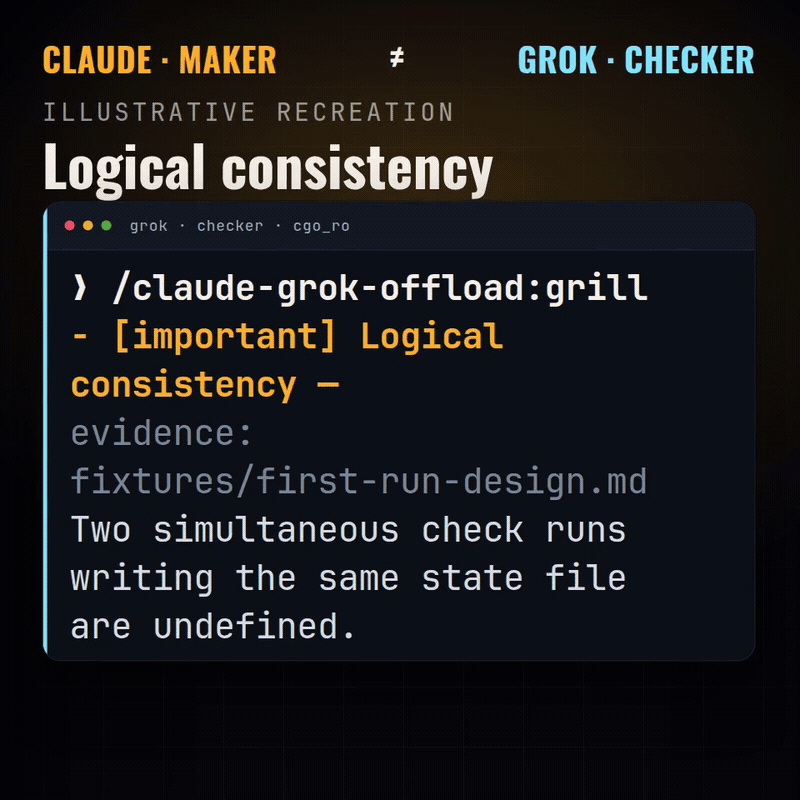

# claude-grok-offload

**Claude Code plugin** that offloads grill / verify / judge / impl / fanout / sweep work to the **Grok CLI** with portable sandbox profiles and a Ready-state check.

MIT License · Independent community product · **Not affiliated with xAI**



*Illustrative recreation of the grill → REVISE moment. Not a recording of a live session.*

## Demo

Illustrative recreation of the terminal flow (self-PASS, grill, REVISE, fixed-design PASS, Ready: yes, modes, install). GitHub does not play these inline.

- [Landscape promo (16:9)](./docs/media/claude-grok-offload-promo-16x9.mp4)
- [Vertical promo (9:16)](./docs/media/claude-grok-offload-promo.mp4)

---

## Install (supported path)

**skills.sh is not supported.** Use Claude Code plugin install only.

### Prerequisites

- [Claude Code](https://code.claude.com)  
- [Grok Build CLI](https://docs.x.ai/build/overview) on `PATH` (or set `GROK_BINARY`)  
- `grok login` already works (`grok models` succeeds)  
- `bash`, `git` · optional `rsync`

### A. Claude Code (slash)

```text
/plugin marketplace add msju199/claude-grok-offload
/plugin install claude-grok-offload@claude-grok-offload-mp
/reload-plugins
/claude-grok-offload:install-sandbox
/claude-grok-offload:check
/claude-grok-offload:grill
```

Expect from **check**: a line `Ready: yes`.  
**grill** with no args uses the package fixture (first success path).

If `@claude-grok-offload-mp` is not accepted by your Claude Code build, use:

```text
/plugin install claude-grok-offload
```

### B. Terminal (same steps, scripts)

After the plugin is installed, `CLAUDE_PLUGIN_ROOT` points at the plugin cache directory (Claude sets this in-session). From a normal shell, clone and run scripts by absolute path:

```bash
git clone https://github.com/msju199/claude-grok-offload.git
cd claude-grok-offload
PLUGIN="$(pwd)/plugins/claude-grok-offload"

bash "$PLUGIN/scripts/install-sandbox-profiles.sh"
bash "$PLUGIN/scripts/cgo-check.sh"          # → Ready: yes
bash "$PLUGIN/scripts/invoke-grok.sh" --mode grill
```

### What “done” looks like (S1 smoke)

1. Plugin installed  
2. `install-sandbox` OK (writes `cgo_ro` / `cgo_impl` into `~/.grok/sandbox.toml`)  
3. `check` → **`Ready: yes`**  
4. `grill` (no path) → grill text (PASS or REVISE both count as “ran”)
---

## Peer comparison

| | **xAI Grok Build plugin (CC)** | **claude-grok-offload (this repo)** |
|--|-------------------------------|-------------------------------------|
| Publisher | xAI (peer / upstream ecosystem) | Independent (MIT) |
| Role | Official-ish Grok Build bridge for Claude Code | Portable **offload contracts** + sandbox install + Ready check |
| Sandbox | Host / product profiles as documented by xAI | Installs `cgo_ro` + `cgo_impl` fragments; runtime uses **`$CGO_SANDBOX` / `$CGO_SANDBOX_WRITE`** |
| Maker≠checker | Per xAI docs | **Documented** procedure + RO defaults — **no** host deny-hook shipped |
| Non-goals | — | No personal path recipes · no vault merge · no skills.sh install · no `read-only` built-in as product profile |

See [NOTICE](./NOTICE) and [THIRD_PARTY.md](./THIRD_PARTY.md).

---

## Security model

| Axis | Behavior |
|------|----------|
| RO modes (grill/verify/judge/fanout-R/sweep) | `--sandbox "$CGO_SANDBOX"` → prefer **`cgo_ro`**, else **`strict` + staging** |
| Write modes (impl / fanout-W) | `--sandbox "$CGO_SANDBOX_WRITE"` → **`cgo_impl`** when installed; **refuse-to-start** if key missing |
| Forbidden | Product never uses built-in sandbox name **`read-only`** as a Ready value |
| Staging | Paths outside portable grants are copied into a per-run dir under plugin data |
| Worktree / staging prepare | Non-temp paths only; staging **rejects hardlink** flags (`--link`, `-H`) |
| Secrets | Do not print secret values; deny globs live in installed fragments |
| Maker≠checker | **Documented tier** (procedure + RO). Operators who need hard gates wire them in their own harness |

---

## S1 definition (success smoke)

**S1** = first-run path a cold machine can complete without personal files:

1. Plugin installed  
2. `install-sandbox-profiles.sh` succeeds (or documents skip)  
3. `cgo-check.sh` prints **`Ready: yes`**  
4. `invoke-grok.sh --mode grill` with **no user path** stages `fixtures/first-run-design.md` and returns grill text  

Evidence for dogfood: Ready:yes + fixture grill output.

- **External testers:** [docs/EXTERNAL-DOGFOOD.md](./docs/EXTERNAL-DOGFOOD.md)  
- **Marketplace submit pack:** [docs/MARKETPLACE-SUBMIT.md](./docs/MARKETPLACE-SUBMIT.md)  
- **Community catalog PR:** https://github.com/jimmc414/claude-code-plugin-marketplace/pull/8  
- **Anthropic directory form:** https://clau.de/plugin-directory-submission  

---

## Commands (slash)

| Command | Mode |
|---------|------|
| `check` | Ready-state machine |
| `install-sandbox` | Install `cgo_ro` / `cgo_impl` fragments |
| `grill` | Adversarial design review (RO; fixture if no path) |
| `verify` | plan / code / fact (RO) |
| `judge` | Option ranking (RO) |
| `impl` | Write impl (5-kan + worktree/staging); **user-invoked** |
| `fanout` | Parallel R/W; **user-invoked** |
| `sweep` | Batch audit from targets file; **user-invoked** |
| `heavy-burn` | Volume playbook; **user-only** |

Write/user-only commands set `disable-model-invocation: true` so the model does not auto-fire them.

---

## Layout

```
plugins/claude-grok-offload/
  commands/   prompts/   scripts/   sandbox/   fixtures/   tests/
docs/REVERSE.md          # reverse Claude checker — document only
examples/                # sweep-targets + fanout-jobs templates
```

State file: `${CLAUDE_PLUGIN_DATA:-~/.claude/plugins/data/claude-grok-offload}/cgo-env`  
Keys: `CGO_SANDBOX` · `CGO_SANDBOX_WRITE` · `CGO_STAGING`

---

## Reverse checks

When **Grok** authored the design, use a separate **Claude** headless session for checker independence.  
See [docs/REVERSE.md](./docs/REVERSE.md) (document only — no reverse wrappers in this repo).

---

## Tests / CI

```bash
chmod +x plugins/claude-grok-offload/scripts/*.sh plugins/claude-grok-offload/tests/test-*.sh
for t in plugins/claude-grok-offload/tests/test-*.sh; do bash "$t"; done
```

GitHub Actions: `.github/workflows/ci.yml` (optional shellcheck, all `test-*.sh`, strip gate).

---

## Unsupported

- **skills.sh** install  
- Personal absolute paths baked into contracts  
- Host `precode-gate` / deny-until-grill hooks  
- Vault merge automation  

---

## License

MIT — see [LICENSE](./LICENSE). Attribution: [NOTICE](./NOTICE).
